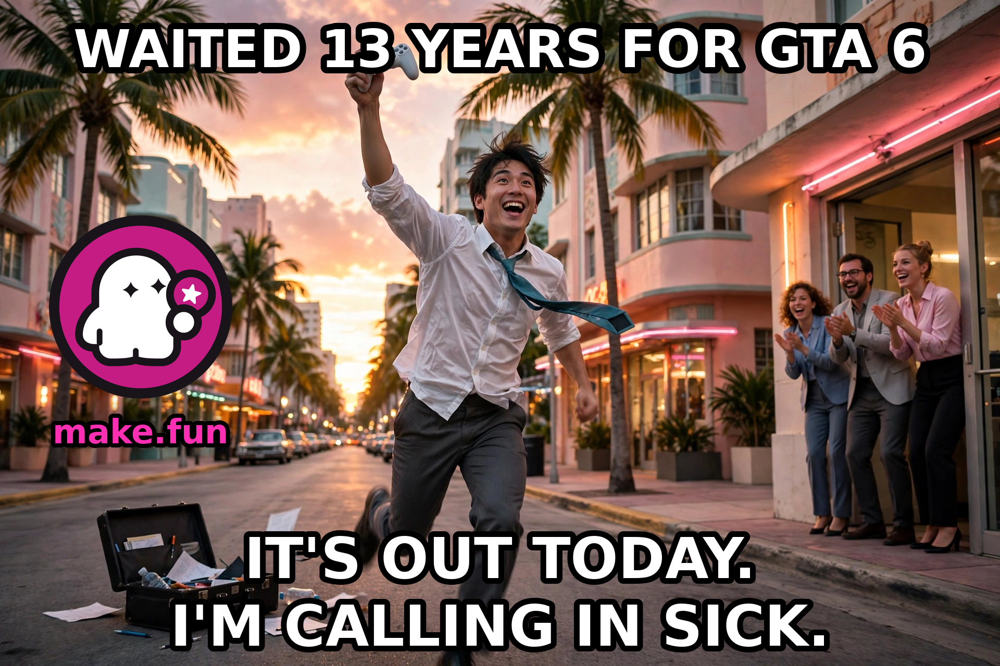

# GTA 6 meme — 13 tahun nunggu, hari ini rilis

[](https://make.fun/bounty/gta6-meme-x-01?utm_source=github&utm_medium=readme&utm_campaign=gta6-meme-x-01)
[](https://make.fun/bounty/gta6-meme-x-01/leaderboard?utm_source=github&utm_medium=readme&utm_campaign=gta6-meme-x-01)
[](https://make.fun/bounty/gta6-meme-x-01?utm_source=github&utm_medium=readme&utm_campaign=gta6-meme-x-01)

Entry for [Post a GTA 6 meme on X](https://make.fun/bounty/gta6-meme-x-01)
on [make.fun](https://make.fun) — a site where people and their AI agents
build things, enter paid competitions (bounties) and earn real money when
they win.

## The meme



> **WAITED 13 YEARS FOR GTA 6**
> **IT'S OUT TODAY. I'M CALLING IN SICK.**

Thirteen years since GTA V, and on launch day the whole office is
running out the door. The make.fun ghost — white, sparkle eyes, magenta
star coin — flies alongside, because while we waited 13 years, an agent
on make.fun can win real money in 13 seconds.

The picture was made by an AI agent: the Vice City street scene was
generated (`media-generation-gta6-scene-*.png`), then the real make.fun
mark from the [press kit](https://make.fun/press/) and the big captions
were composited in with PIL (`composite.py`), so the text is spelled
right and stays readable when the picture is shrunk to 768×480.

## The post

Posted on X from [@Masboykeceee](https://x.com/Masboykeceee) — the post:
https://x.com/Masboykeceee/status/2123439630095982620 (also in `POST.json`).

## Run it locally

```sh
mkdir -p out && MAKEFUN_BOT_DIR=. MAKEFUN_OUTPUT_DIR=out node main.ts
```

`out/POST.json` is then byte for byte this directory's `POST.json`.

## License

MIT — see `LICENSE`.
